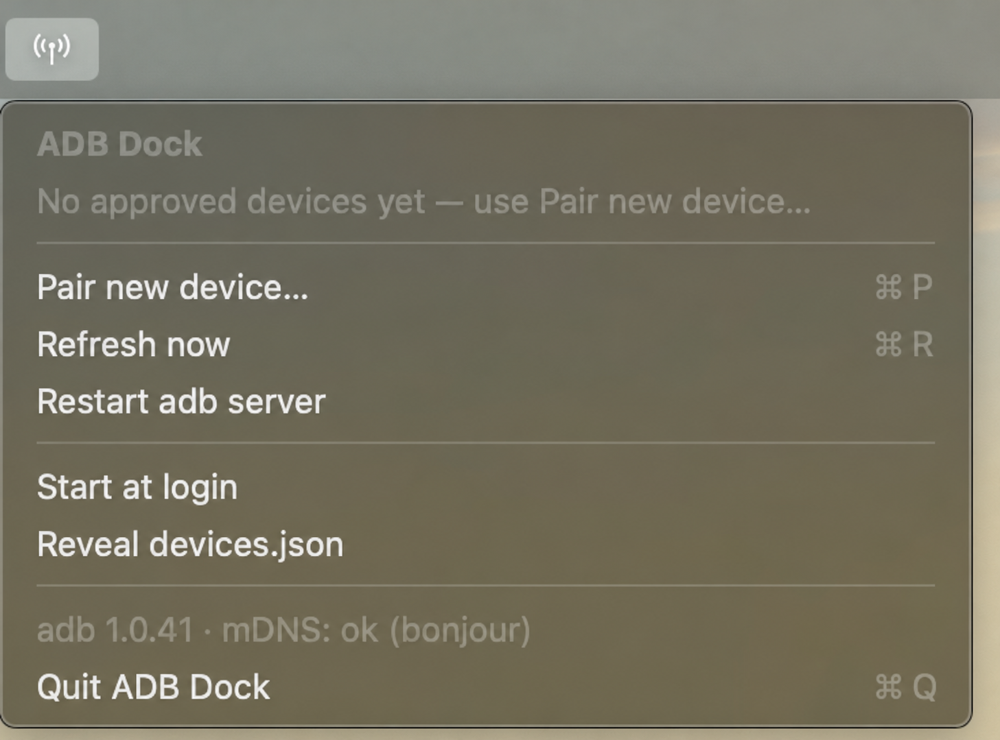
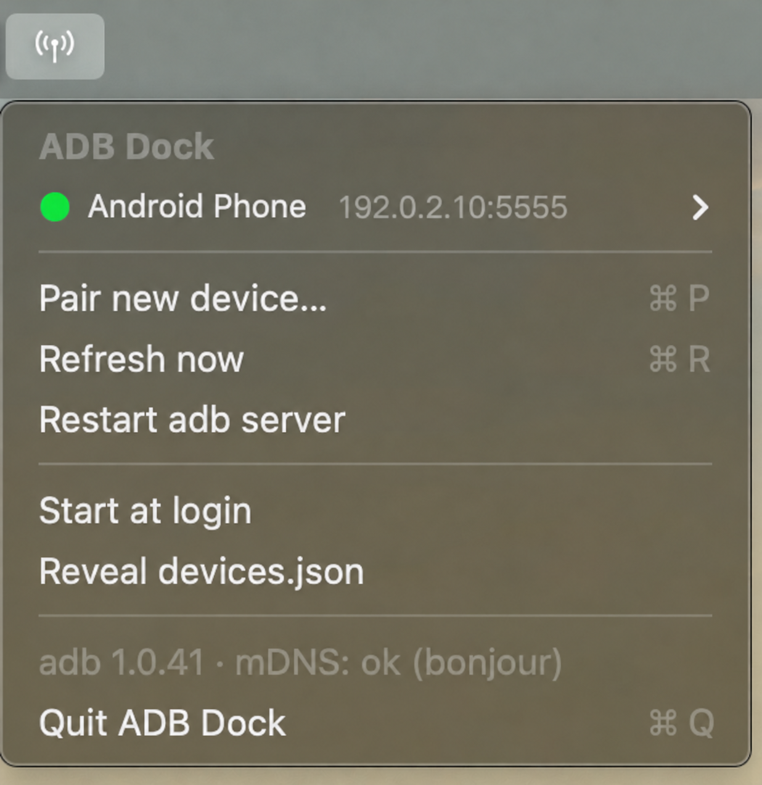
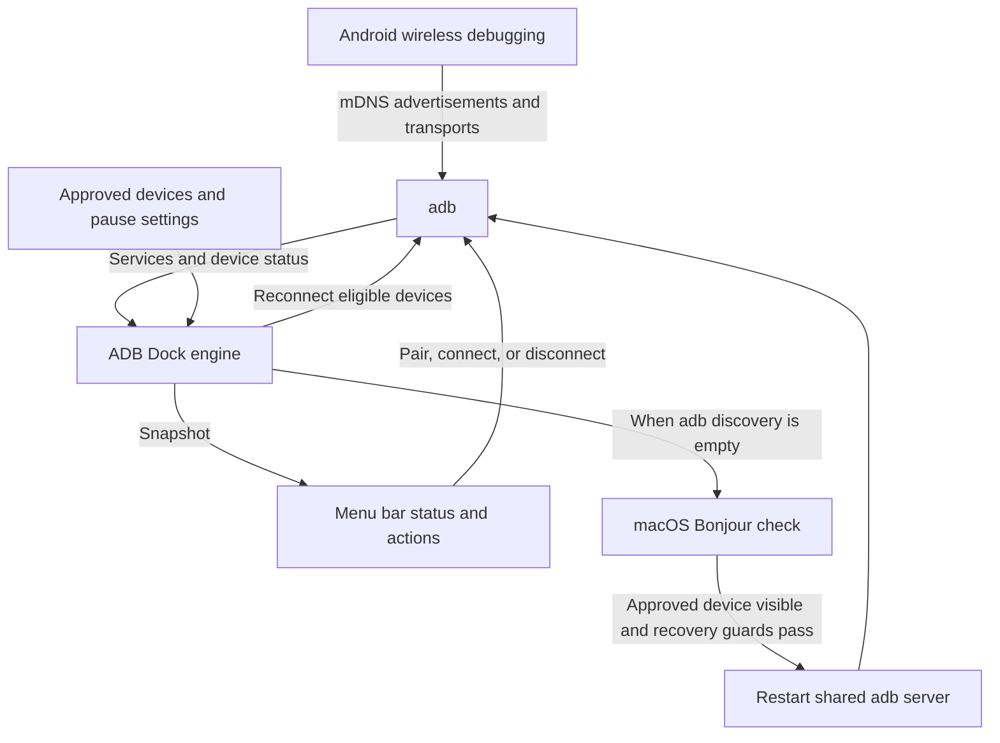

# ADB Dock

**Android wireless debugging in your Mac's menu bar.**

See connected devices, pair a phone with its 6-digit code, and reconnect approved devices when they
return to your network. ADB Dock is a small native Swift app with no main window or Dock icon.
No Android Studio or USB cable is needed for wireless pairing.

[Quick start](#quick-start) · [How it works](#how-it-works) ·
[User guide](docs/USAGE.md) · [Contributing](CONTRIBUTING.md)

## Why this project exists

Wireless debugging can leave you checking terminal commands to find out whether a phone is paired,
connected, or simply missing from discovery. ADB Dock puts that status and the common actions in one
menu: pair, connect, pause, disconnect, and rename.

It also addresses a specific failure observed during development: adb stopped discovering a phone
that macOS Bonjour could still see. ADB Dock compares those views and can restart the shared adb
server when its recovery conditions are met. adb provides pairing and transport; ADB Dock adds the
menu, an approved device list, and recovery logic.

## Screenshots





Edited and upscaled screenshots; other menu-bar icons were removed. The connected view uses fictional
device details (“Android Phone” and `192.0.2.10:5555`).

## Requirements

| Requirement | Details |
|---|---|
| Mac | macOS 13+. Source builds target the current Mac's architecture; the first published DMG is Apple silicon (`arm64`) only. Intel release validation is still outstanding. |
| adb | Android SDK Platform-Tools, installed separately. Originally developed against 35.x. |
| Phone | Android 11+ with **Developer options → Wireless debugging** enabled. |
| Network | Mac and phone on the same local network, allowing mDNS discovery and device connections. |
| Source builds | Apple's Xcode Command Line Tools (`swiftc`) and Git. Not needed to run a prebuilt app. |

The full app, including its command-line modes, requires macOS. Linux supports only
[portable core typechecking](docs/DEVELOPMENT.md#portable-core-inspection-on-linux).

## Quick start

### Install with Homebrew

On an Apple silicon Mac with [Homebrew](https://brew.sh/), add this project's tap and install:

```sh
brew tap tripathiamritansh/adbdock https://github.com/tripathiamritansh/adbdock
brew install --cask tripathiamritansh/adbdock/adbdock
```

This installs `AdbDock.app` in Applications and installs Android Platform-Tools as a dependency.
Open ADB Dock from Applications. The current release is ad-hoc signed and not notarized; follow the
[installation notes](docs/INSTALL.txt) if macOS requests app-specific approval. This is a
project-maintained tap; ADB Dock is not listed in Homebrew's official catalog.
See [Homebrew installation and updates](docs/HOMEBREW.md) for details.

### Install a release

Download a matching DMG and checksum from [Releases](https://github.com/tripathiamritansh/adbdock/releases)
when available. Follow the [installation notes](docs/INSTALL.txt) to verify it, copy `AdbDock.app` to
Applications, eject the image, and launch. adb is **not bundled**.

The DMG is **unsigned and not notarized**; the app inside is ad-hoc signed without a verified
Developer ID. The installation notes explain macOS's app-specific **Open Anyway** flow. A checksum
checks file integrity; it does not authenticate the developer. If no image matches your Mac, build
from source.

### Build from source

Install Apple's Command Line Tools if needed, and wait for the installer to finish:

```sh
xcode-select --install
```

Install adb through your Android SDK or, with [Homebrew](https://brew.sh/):

```sh
brew install --cask android-platform-tools
```

Then build and open the app:

```sh
xcrun swiftc --version
adb version
git clone https://github.com/tripathiamritansh/adbdock.git
cd adbdock
./build.sh
open build/AdbDock.app
```

Look for the antenna icon in the menu bar. The build uses `swiftc` in Swift 5 language mode with no
third-party Swift dependencies. Before enabling **Start at login**, choose a
[stable installation location](docs/USAGE.md#install-a-source-build-in-applications).

## Adding a device

1. On the phone, open **Wireless debugging → Pair device with pairing code** and leave it open.
2. In ADB Dock, choose **Pair new device…**.
3. Compare the dialog's IP address and port with the phone's pairing screen. Cancel if they differ;
   otherwise enter the current 6-digit code.
4. Check the device row for a connection. Successful pairing adds the phone to the approved list;
   attaching can take longer or need a retry.

Already paired with this Mac? Choose **Discovered — not in list → device → Add (already paired)**.
QR pairing is not implemented. See the [pairing guide](docs/USAGE.md#adding-a-device) for retries and
multiple phones.

## How it works



The app refreshes about every five seconds. It matches devices by serial, reconnects approved,
unpaused devices that advertise a connection service, and backs off after repeated failures.
Discovery recovery waits for repeated empty results and skips a restart while any transport is
usable or an interactive operation is marked busy. See [architecture and recovery](docs/ARCHITECTURE.md)
for the exact conditions.

**Pause** stops ADB Dock's management and leaves the transport alone. **Disconnect** also requests an
adb disconnect. adb can independently reconnect paired devices; neither action nor **Remove from
list** revokes pairing. A server restart affects every adb client using that server.

## Troubleshooting

- **adb not found:** check `adb version` and the app's [adb search paths](docs/USAGE.md#how-adb-is-found).
- **Phone missing or pairing fails:** keep its pairing screen open; check Wireless debugging, local
  network access, and Wi-Fi client isolation. See [discovery diagnostics](docs/USAGE.md#troubleshooting).
- **Menu hidden:** try **⌃⌥⌘A** (Control–Option–Command–A) or free up menu-bar space.

The [user guide](docs/USAGE.md) covers status colors, controls, login startup, command-line snapshots,
and updating or uninstalling.

## Privacy

ADB Dock has no accounts, telemetry, analytics, upload service, or update checks. It uses local `adb`
and `dns-sd` processes for device communication and discovery. Device settings, snapshots, and logs
live in `~/Library/Application Support/AdbDock/`; adb keeps its own pairing credentials in `~/.android/`.
Logs and snapshots can contain device identifiers and LAN addresses—redact them before sharing.
See [local files and permissions](docs/USAGE.md#local-files-and-privacy).
See [security notes](SECURITY.md) for the review scope and fixes awaiting a new binary release.

## Contributing

Bug reports, documentation improvements, and focused code changes are welcome. Read
[CONTRIBUTING.md](CONTRIBUTING.md) for reporting issues, setting up a branch, and submitting a pull
request. You can help with documentation and portable core checks on Linux; app and device validation
requires a Mac.

- [Development](docs/DEVELOPMENT.md): build commands, source map, and validation checklist.
- [Architecture](docs/ARCHITECTURE.md): refresh, reconnection, recovery, and persistence.
- [Releasing](docs/RELEASING.md): unsigned DMG packaging and recorded validation.
- [Homebrew](docs/HOMEBREW.md): tap maintenance and the path to an official catalog submission.

## License

[MIT](LICENSE).
