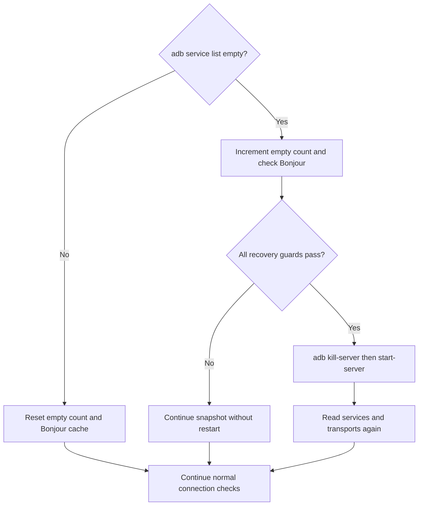

# How ADB Dock works

ADB Dock is a native Swift menu bar app. AppKit supplies the menu and dialogs, Carbon registers the
global shortcut, and Foundation handles processes and local files. It invokes the separately installed
`adb` and macOS `dns-sd` executables; it has no backend service or third-party Swift libraries.

See the [README flowchart](../README.md#how-it-works) for the system overview and the
[source map](DEVELOPMENT.md#source-layout) for file responsibilities.

## Refresh and connection flow

1. At launch, `Store` loads approved devices from `devices.json`. The app schedules a refresh roughly
   every five seconds, skipping a timer tick if a refresh is already running.
2. On a background queue, `Engine` asks adb for mDNS services and transports (`adb devices -l`).
   A *transport* is adb's connection to a device. An mDNS advertisement alone does not mean it is connected.
3. If discovery is empty, the engine checks Bonjour and evaluates the recovery conditions below.
4. It attempts a connection for each approved, unpaused device with a connection advertisement and
   no usable transport. An `unauthorized` transport is left for the user to resolve. Retries wait at
   least 20 seconds, increasing to five minutes after three consecutive failures for that device.
5. It constructs a snapshot of approved and discovered devices. The main queue updates the menu's
   backing snapshot and tooltip, writes `state.json`, and logs connection results. The menu is rebuilt
   when it opens.

Identity comes from the serial: mDNS instance suffixes and connection ports can change. Approved
devices have saved labels and pause settings; discovered devices have not been added to that list.

| Internal state | Evidence | Menu display |
|---|---|---|
| `connected` | Matching transport in adb's `device` state | Green dot and address, `USB`, or `wireless` |
| `offline` | Matching transport in another state | Orange dot with `offline` or `unauthorized` |
| `advertising` | Connection advertisement, no matching transport | Yellow dot with `connecting…` or `connect failed — pair it?` |
| `absent` | Neither transport nor connection advertisement | Hollow dot and `not on network` |

Pause is a separate saved flag, displayed alongside the underlying state. It suppresses ADB Dock's
automatic connection attempts and excludes that device as a reason to restart the server. adb's own
auto-connect behavior continues independently.

## Discovery recovery

The motivating failure was an adb discovery client that stopped seeing a phone still visible to
macOS Bonjour. When adb returns no services, ADB Dock uses `dns-sd` to look for
`_adb-tls-connect._tcp` advertisements, caching that browse for about 15 seconds.

All guards must pass: automatic management is enabled, at least three consecutive service lists were
empty, Bonjour sees an approved and unpaused device, no transport is in the usable `device` state,
no interactive operation is marked busy, and more than five minutes have elapsed since the last
automatic restart in this process.

This is a recovery heuristic. Restarting affects the shared server, including other adb clients and
paused devices; the app cannot know about every external adb operation. A manual **Restart adb server**
runs directly. Finish other adb work before using it or
[testing recovery](DEVELOPMENT.md#exercise-the-discovery-recovery-condition).

ADB Dock passes `ADB_MDNS_OPENSCREEN=0` to adb subprocesses to request the Bonjour backend where
supported. It does not reconfigure an already-running server; behavior depends on the installed
Platform-Tools version.

## Pairing and menu actions

The app delegate handles user actions through `Adb`. Pairing reads a `_adb-tls-pairing._tcp`
advertisement and calls `adb pair` with the address and user-entered code. Because mDNS is
unauthenticated, the user must compare the address and port with the phone. After success, the app
looks for a connection advertisement, attempts to attach, and saves the device to the approved list.
Pairing establishes trust; attaching establishes a usable transport.

**Pause** changes management only. **Disconnect** also requests `adb disconnect`. **Remove from list**
removes the local entry and leaves adb's pairing credentials intact. See the
[user guide](USAGE.md#device-controls-and-status) for all menu actions.

## Persistence and diagnostics

`Store` locks access to its in-memory device list and writes JSON atomically. Explicit list changes
save immediately; last-seen metadata is saved at most about once every five minutes during snapshots
that see an approved device. Missing `paused` fields decode as `false` for older saved entries.

The running app writes `state.json` with each refreshed timestamp. `app.log` is truncated at GUI
launch and records actions, recovery, and menu diagnostics. See
[local files and privacy](USAGE.md#local-files-and-privacy) for paths and requested permissions.

`--dump` and `--menu` use the same engine with automatic connection and recovery disabled. They still
initialize AppKit and call adb, which may start its daemon and auto-connect independently; snapshots
can also update last-seen metadata. These modes require macOS. The process runner bounds adb command
duration and captured output; the [development guide](DEVELOPMENT.md) covers validation and the
discovery fault-injection flag.
