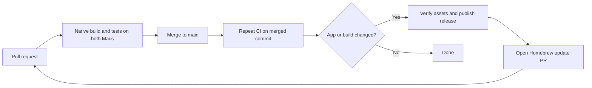

# Releases and CI

[CI and release](../.github/workflows/ci.yml) runs on every pull request and every push to `main`.
It builds natively on Apple silicon (`macos-15`) and Intel (`macos-15-intel`), runs the security
regressions and empty-device CLI smoke tests, verifies signing, and creates and mounts both DMGs.
Release-tooling tests run on Linux. The stable **CI** check passes only when all these checks pass.

## Automatic releases

After a merge, the `main` run publishes a release only when the push changes `Sources/`, `Tests/`,
`scripts/`, `.github/workflows/`, `build.sh`, `VERSION`, `docs/INSTALL.txt`, or `LICENSE`.
Documentation and Homebrew-only merges still run CI but do not release. The install notes and license
are included because they are bundled in the DMG. An authorized history rewrite triggers a full
build and release without requiring the removed commits to be fetched.



`VERSION` sets the local source-build version, currently `1.1.0`. CI uses its major and minor
components plus GitHub's workflow run number: run 42 produces `1.1.42` and tag `v1.1.42`.
Run numbers include PRs, so gaps are expected. A retry keeps the same version. Change the major/minor
in `VERSION` when starting a new release series; keep the workflow file identity to preserve numbering.

Each release contains a DMG, SHA-256 sidecar, and original build-info file for **each** architecture.
Publishing requires all six files, correct checksums, and clean-source provenance matching the tested
commit. It first uploads to a draft, verifies GitHub's asset sizes and digests, then publishes. Existing
public assets and tags are never replaced. An older run does not force itself to become the latest release.

The next job downloads the public checksum sidecars and opens a cask update PR. It explicitly starts
CI on that branch because PRs opened with `GITHUB_TOKEN` do not trigger another workflow automatically.
Review and merge the cask separately after the [Homebrew checks](HOMEBREW.md#maintain-the-cask).
That metadata-only merge does not release again. No personal access token is needed.

### Repository settings

In [Actions settings](https://github.com/tripathiamritansh/adbdock/settings/actions):

- Allow GitHub Actions and the pinned official `actions/*` actions used by the workflow.
- Enable **Allow GitHub Actions to create and approve pull requests** for the cask-update job.
  The workflow only creates PRs; it does not approve or merge them. Job-specific write permissions
  are declared in YAML; PR build jobs use read-only repository permissions.

After the first successful run, import [main-ruleset.json](../.github/main-ruleset.json) in
[Repository rules](https://github.com/tripathiamritansh/adbdock/settings/rules) and confirm it is **Active**.
It requires a PR, resolved review threads, an up-to-date branch and the GitHub Actions **CI** check,
and blocks branch deletion and force pushes without bypass actors. It permits zero approving reviews
so a sole maintainer can merge their own PR after CI. Increase that count when another reviewer is available.
Committing this JSON alone does not activate protection.

### Retry or release manually

Re-run failed jobs from the original Actions run. A same-commit draft can resume uploading; a published
release is left untouched. If Homebrew PR creation fails, enable the setting above, then open the **Homebrew** workflow, choose
**Run workflow** on `main`, and enter the already-published version without `v` (for example `1.1.1`).
This retries the cask update without rebuilding or publishing another app release. Retries merge the
existing automation branch with current `main`, preserve branch edits, and never force-push. Conflicts
stop the job for manual resolution. The job annotation includes the GitHub error and the logs link a
manual PR creation page.
A release can succeed even if its subsequent cask PR fails; the cask remains at its previous version.

For an intentional new release without a source change, choose **Run workflow** on `main` in Actions.
It runs all checks and uses a new run number. Manual runs on other branches run CI without publishing.
Never move an existing release tag or upload replacement bytes to a public version; fix and release a new version.

## Build locally on a Mac

With macOS 13+ and Apple's Command Line Tools, run from the repository root:

```sh
./scripts/package-dmg.sh
# Optional explicit version:
APP_VERSION=1.2.0 ./scripts/package-dmg.sh
```

The script builds the host architecture, stages and ad-hoc signs the app, creates an unsigned image,
verifies its integrity and read-only mount, compares files, checks the Applications shortcut, then ejects.
Outputs go to ignored `build/release/`, for example:

```text
AdbDock-1.1.0-arm64-unsigned.dmg
AdbDock-1.1.0-arm64-unsigned.dmg.sha256
AdbDock-1.1.0-arm64-unsigned.build-info.txt
```

`--skip-build` packages an existing bundle without proving it matches the source. CI uses it immediately
after building and testing in the same clean checkout. The staged copy is signed; the input bundle is
unchanged. Timestamps can differ between builds, so byte-for-byte reproducibility is not claimed.
If detachment fails, follow the printed detach command before deleting retained temporary files.

The image contains only `AdbDock.app`, an `/Applications` shortcut, `INSTALL.txt`, and `LICENSE`.
adb is installed separately. Verify a downloaded image using its matching sidecar:

```sh
shasum -a 256 -c AdbDock-1.1.0-arm64-unsigned.dmg.sha256
hdiutil verify AdbDock-1.1.0-arm64-unsigned.dmg
```

Use the filenames of the version and architecture you downloaded. Then follow [INSTALL.txt](INSTALL.txt).
The DMG is unsigned and not notarized; the app is ad-hoc signed without a verified Developer ID.
A checksum detects changes but does not authenticate the developer.

## Checks that still need a person

CI does not validate real-phone pairing/reconnection, GUI interaction, the global shortcut, login startup,
Homebrew install/upgrade/removal, or downloaded-app Gatekeeper approval. Use the
[development checklist](DEVELOPMENT.md#app-and-device-behavior) on the supported Mac architectures and
record which checks were actually run. Do not disable Gatekeeper globally or recursively remove quarantine.

## Historical v1.0 validation

The original image is **arm64 only**, built on macOS 15.6.1 (24G90), Apple Swift 6.1 in Swift 5 mode,
targeting macOS 13. Its SHA-256 is:

```text
903ff2389ce7b7a8ac907986325e8365dd3256e676ce4fe3805744533815e877
```

Native build, signature, DMG integrity/mount, file comparison, isolated installation/launch, and the
installed empty-device `--dump`/`--menu` checks passed. Menu visibility was confirmed; the antenna
returned after reducing menu-bar crowding. Real-device and login behavior were previously reported
by the maintainer, not repeated for packaging. Downloaded-app Gatekeeper and Intel were not tested.
The local adb version was 35.0.2. The README screenshots are edited examples, not hardware test evidence.

For that v1.0 image, `Sources/`, `build.sh`, and `LICENSE` matched commit
`bd30de7cb2393322b9e94502ba726ad560c2d9af`. The release tag includes the packaging inputs and docs.
Its original build-info records a dirty checkout and `skip-build=true`: packaging was retried after a
sandbox mount limitation. Preserve that original record; it describes v1.0, not the current source.
